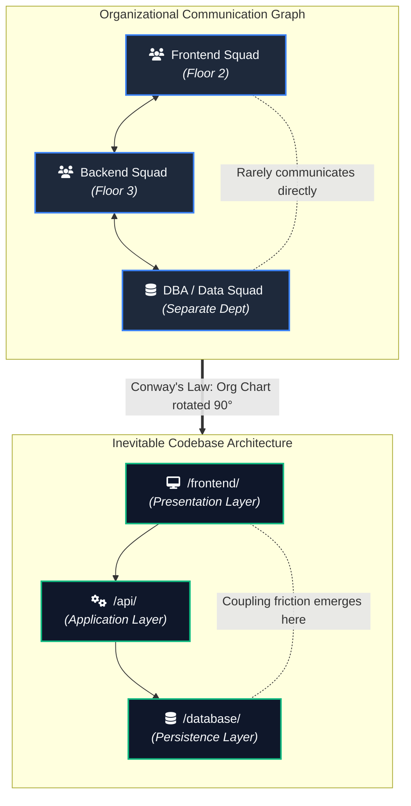
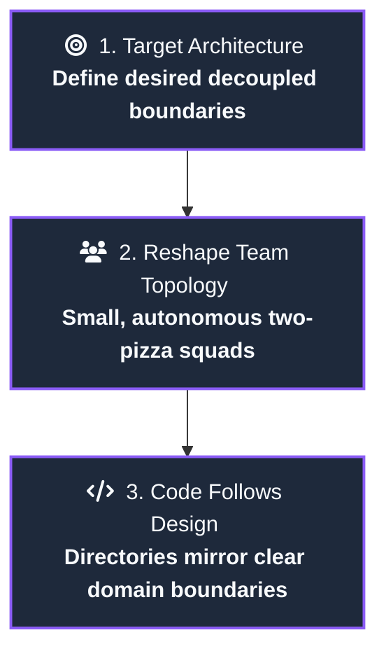
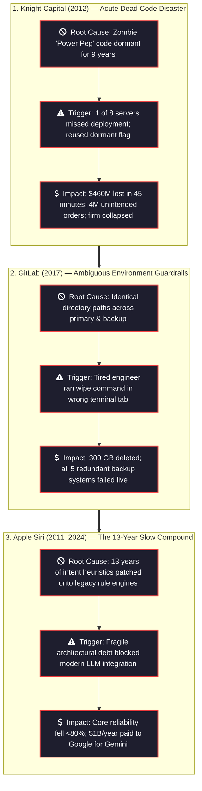
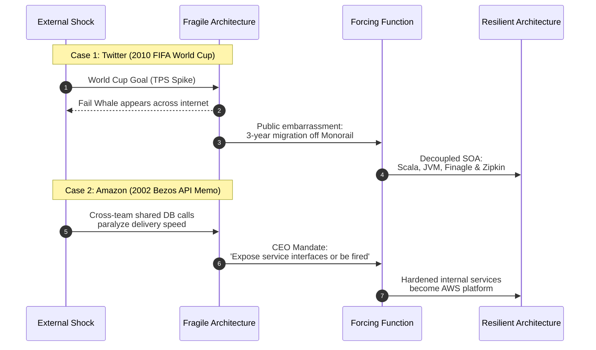

# 📁 Topic 01: File Structure & Codebase Architecture
### *The Architecture of Intent — Where You Put Things Is the Architecture*

[](#-articles-roadmap)
[](#-about-this-topic)

This topic explores the physical organization of production codebases across every experience level—from beginners building their first production service to staff architects and tech leads with 10+ and 15+ years of experience leading enterprise systems. It analyzes why folder layouts create default communication patterns, how technical debt accumulates silently in unowned directories, and how to define crisp module boundaries before external forcing functions break your system.

---

## 📊 Architectural Visuals & Diagrams

### 1. Conway's Law: How Organization Topologies Dictate Directory Structures

When teams communicate in silos, the codebase inevitably mirrors those silos. The directory tree is the organizational chart rotated ninety degrees:



---

### 2. The Inverse Conway Maneuver

Senior architects don't try to solve structural chaos with code refactoring alone. They reshape the communication graph first:



---

### 3. The Spectrum of Structural Failure

Structural debt does not stay inside folders—it leads to high-profile production failures:



---

### 4. Forcing Functions: Why Architecture Refactorings Actually Happen

Teams don't refactor code because clean code is virtuous. They refactor when the cost of living with the broken structure exceeds the cost of tearing it apart:



---

## 🗂️ Topic Structure

```text
01-filestructure/
├── README.md                                  # Topic overview, visuals & article roadmap
└── articles/                                  # 📖 Publication-ready Markdown essays
    ├── README.md                              # Articles index and reading sequence
    └── 01-your-folder-structure-is-a-message.md # Part 1: Full publication essay
```

---

## 📚 Articles Roadmap

| Part | Title | Status | Target Length | Markdown Article |
| :---: | :--- | :---: | :---: | :---: |
| **01** | **Your Folder Structure Is a Message. Most Teams Are Sending the Wrong One.** | ✅ Published | 1,733 words (~8 min) | [Read Part 1](articles/01-your-folder-structure-is-a-message.md) |
| **02** | **The First Cut: How Module Boundaries Get Drawn and Why They Drift** | ✍️ Ready | ~2,100 words (~9 min) | [Read Part 2](articles/02-the-first-cut-how-module-boundaries-get-drawn.md) |
| **03** | **The Universal Root: Every Folder Explained** | ⏳ Planned | ~1,600 words (~7 min) | Coming soon |
| **04** | **How Structure Evolves: The Same Repo at 5, 20, and 50 Engineers** | ⏳ Planned | ~1,800 words (~8 min) | Coming soon |
| **05** | **The Blast Radius Audit: Diagnosing Coupling Before It Causes an Outage** | ⏳ Planned | ~2,000 words (~9 min) | Coming soon |
| **06** | **Modular Monolith to Microservices: The Distributed Inflection Point** | ⏳ Planned | ~2,000 words (~9 min) | Coming soon |

---

## 🔬 Core Case Studies & Empirical Data in Part 1

- **Conway's Law & The Inverse Conway Maneuver**: Empirical verification by [MIT and Harvard Business School](https://www.hbs.edu/ris/Publication%20Files/08-039_1861e507-1dc1-4602-85b8-90d71559d85b.pdf).
- **The $460M Dead Code Loss**: Knight Capital's 2012 catastrophe documented in the [SEC Administrative Proceeding](https://www.sec.gov/litigation/admin/2013/34-70694.pdf).
- **GitLab 300GB Database Deletion**: How indistinguishable directory naming contributed to live data loss ([GitLab 2017 Postmortem](https://about.gitlab.com/blog/2017/02/01/gitlab-dot-com-database-incident/)).
- **Apple Siri's 13-Year Structural Debt**: Craig Federighi's confirmation of the failed hybrid attempt and the subsequent $1B/year Gemini licensing deal.
- **Twitter 2010 World Cup Fail Whale**: Eyewitness on-call account and Twitter Engineering's retrospective on migrating off the Monorail to Scala/JVM.
- **Amazon 2002 Bezos Mandate**: How CEO-mandated interface boundaries eliminated coordination friction and accidentally gave birth to AWS.
- **Global Technical Debt**: Stripe's landmark global research study, [The Developer Coefficient](https://stripe.com/files/reports/the-developer-coefficient.pdf), detailing the $300B annual cost of technical debt and maintenance, paired with [Martin Fowler's Technical Debt](https://martinfowler.com/bliki/TechnicalDebt.html) architectural framework.

---

## 🔬 Core Case Studies & Empirical Data in Part 2

- **The 70% Navigation Tax**: IEEE empirical investigation ([Minelli, Mocci, and Lanza, SANER 2015](https://doi.org/10.1109/SANER.2015.7081849)) demonstrating developers spend 70% of time reading and navigating code versus 5% writing code, paired with Robert C. Martin's 10:1 reading ratio.
- **The AI Code Quality Crisis**: GitClear's 2024 empirical study ([Coding on Copilot](https://www.gitclear.com/coding_on_copilot_data_shows_downward_pressure_on_code_quality)) analyzing **153 million lines of code**, revealing code churn doubling, copy-paste proliferation, and refactoring collapse.
- **The Expand-Contract Migration Pattern & Postgres Lock Queues**: Four-deployment parallel change pattern ([Pramod Sadalage and Martin Fowler](https://martinfowler.com/books/refactoringDatabases.html)) ensuring zero-downtime rolling deploys, paired with PostgreSQL `ACCESS EXCLUSIVE` lock arrival queue connection exhaustion mitigation (`SET lock_timeout = '2s'`).
- **Migration Checksum Immutability**: [Flyway Checksum Calculator](https://documentation.redgate.com/fd/checksum-calculator-184127411.html) and Liquibase cryptographic verification preventing split-brain staging/production state.
- **Stripe Immutable Ledger Architecture**: Recording money movement exclusively as append-only event streams of balanced debits and credits rather than destructive balance row mutations.
- **Architectural Fitness Functions**: Continuous automated structural assertions ([Neal Ford, Rebecca Parsons, and Patrick Kua](https://evolutionaryarchitecture.com/)) in CI via ArchUnit, Shopify Packwerk, and ESLint boundary rules.
- **Regulatory Segregation of Duties (SoD)**: [Sarbanes-Oxley Act (SOX) Section 404 ITGC](https://www.sec.gov/rules/final/33-8238.htm) and SOC 2 Type II CC6.1 compliance enforced via `CODEOWNERS` and branch protection rules.
- **Language-Enforced Encapsulation**: Russ Cox's compiler-enforced package boundary specification ([Go 1.4 Internal Packages](https://go.dev/doc/go1.4#internalpackages)).
- **Monorepo Scale & Modern Task Runners**: Uber's 50M LOC Go monorepo migration and Casey Rodarmor's [`just`](https://github.com/casey/just) task runner replacing Makefiles.

---

## 🧭 Navigation
- [← Back to Master System Design Index](../README.md)
